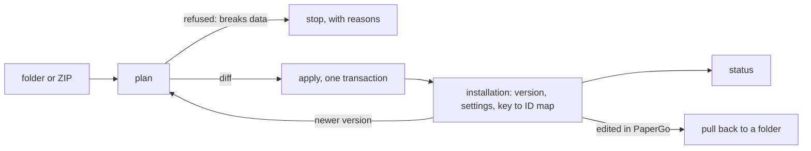

# Solutions (plan)

Status: steps 1 to 3 implemented on `feature/solutions`: the folder format and `papergo solution pack`, and planning, applying, the installation and its status in the API and the command line, as [Solutions](../solutions.md) describes. Two things were built differently from what follows: the installation is one document per workspace in the settings store (key `solutions`), not two tables, and plan and apply answer at once instead of starting an operation, since applying is a short transaction. Routes are under the workspace (`/v1/workspaces/{id}/solutions/{key}`). The samples are converted in step 1b. Steps 1b and 5 are done too: the Diesel and Receipts samples are solution folders. Steps 0, 4 and 6 are planned. [Workspace apps](workspace-apps.md) names solutions as its next step: "lists, workflows and apps installed together into an existing workspace, upgraded in place and removed together". This plan says how, starting from what a real installation needed.

## Why

A household installed the Diesel and Receipts samples into one Spanish workspace and then had to keep it maintainable with real data in it. Everything worked, but only with scripts written around PaperGo:

| What the installer wanted | What it took today |
| --- | --- |
| Both samples in one workspace | Merging two `manifest.json` files by hand, because an import always creates a new workspace |
| Change an app or a workflow and "upload everything again" | A 500-line reconciler against the REST API (match by key, create or update, refuse what breaks data) and a file that remembers which ID each key has |
| Know the lists still have the fields the app needs | Nothing; a missing or retyped field shows as a broken dashboard |
| Names in Spanish | A rename script; choice values could not be translated because workflows match on them |
| One place for the tank's capacity, the time zone, who is asked | The same value typed into a workflow's parameters and an app's parameters, and `UTC` typed where the organization already says `Europe/Madrid` |
| Know why receipts are not read | Reading startup logs: the sample needs a batch AI provider and says so only in its README |

The reconciler proved the model: with keys, a plan and an additive-only rule, applying the same folder twice changes nothing, an edited app becomes a new version, a new optional field arrives without touching 44 stored items, and a retyped field is refused. What it also showed is that this belongs in PaperGo: every consumer would otherwise write the same script, each with its own idea of what is safe.

The model is the one SharePoint people know from PnP provisioning: a template that describes fields, content types and lists, **applied to a site that already exists**, as a delta, without content; and an app package with a version that is upgraded in place.

## Principles

1. **A solution carries definitions, never content.** Items, files, people and permissions stay where they are. Demonstration data is a workflow someone runs, as `diesel-sample-data` already is.
2. **A solution declares what it needs and PaperGo checks it.** The lists and libraries it uses, with their content types and fields, are a contract. PaperGo creates what is missing, verifies what exists, and says what does not fit before anything changes.
3. **Applying is a plan first.** Every change is shown as a diff and applied in one transaction, as an import is today. Applying the same version twice changes nothing.
4. **Additive by default.** Applying never deletes and never changes what stored values mean. A field's type, a removed choice, a field leaving a type, a list becoming a library: refused, with the reason, unless the solution brings an explicit migration (later).
5. **Keys are identity.** Everything a solution owns has a stable key. PaperGo remembers which object each key became in each installation, so renames and upgrades update in place.
6. **One format for writing and for shipping.** The folder a developer edits is the package. The format is the one the samples already use.

## What a solution is

A folder, or its ZIP:

```
diesel/
  solution.json            identity, version, what it needs, settings, collections
  workflows/levels.json    a workflow's settings, naming levels.ts beside it
  workflows/levels.ts
  apps/dashboard.json      an app's settings, naming dashboard.tsx beside it
  apps/dashboard.tsx
  locales/es.json          display names in other languages (later)
```

`solution.json`, shortened:

```json
{
  "key": "diesel",
  "name": "Diesel tracker",
  "version": "1.2.0",
  "papergo": ">=0.2.0",
  "requires": { "ocr": false, "ai.batch": false },
  "settings": {
    "type": "object",
    "properties": {
      "capacity_l": { "type": "number", "title": "Tank capacity (L)", "default": 750 },
      "time_zone":  { "type": "string", "title": "Time zone", "default": "=organization.time_zone" },
      "assignees":  { "type": "array", "title": "Who measures", "default": ["role:owners"] }
    }
  },
  "fields": [
    { "key": "diesel_stick_cm", "label": "Stick reading (cm)", "type": "decimal", "scale": 1, "required": true, "indexed": true }
  ],
  "content_types": [
    { "key": "diesel_reading", "name": "Reading", "fields": ["diesel_measured_at", "diesel_stick_cm", "diesel_level_liters"] }
  ],
  "collections": [
    {
      "key": "tank",
      "kind": "list",
      "name": "Diesel",
      "content_types": ["diesel_reading", "diesel_purchase"],
      "search": false,
      "views": [{ "key": "readings", "name": "Readings", "is_default": true, "query": { "content_type_id": "$type:diesel_reading" } }]
    }
  ]
}
```

A workflow's or an app's settings file is what the samples have now, with two kinds of placeholders instead of `$LIST` bound by a test:

```json
{ "key": "diesel-levels", "name": "Diesel levels", "script": "levels.ts",
  "parameters": { "list": "$collection:tank", "reading_type": "$type:diesel_reading", "capacity_l": "$setting:capacity_l" } }
```

- **`$collection:<key>` and `$type:<key>`** name what the solution declares. They become IDs when it is applied. The parameters forms already type these values (`"x-papergo": {"kind": "collection"}`), so a reference of the wrong kind is caught at pack time.
- **`$setting:<key>`** takes a value of the solution's settings form, asked once at installation. The tank's capacity is then typed once and reaches the workflow and the dashboard alike. `=organization.time_zone` defaults a setting to an organization preference.
- **`requires`** names capabilities of the deployment: `ocr`, `ai.chat`, `ai.batch`, `embeddings`. `true` refuses installation without it; `false` installs and reports it as missing in the status. Features already register themselves at startup; each also registers the capability names it provides.
- **`papergo`** is the range of PaperGo versions the solution was written for. Installing outside it is refused with both versions named.

A solution has no users, grants, items, files, runs or IDs.

## The contract: collections a solution needs

Each entry of `collections` is a **slot**: a list or library the solution works on. At installation every slot is either created or **bound** to one that exists.

| | Created | Bound to an existing list or library |
| --- | --- | --- |
| When | no collection is chosen for the slot | the installer picks one |
| Name, kind, settings | from the solution | kept as they are; the kind must match |
| Content types | attached | attached when missing |
| Fields | created in the catalog and added to the types | verified; missing ones added |
| Views | created | created beside its own |

Verifying a field compares what cannot change in PaperGo: key, type, scale, multiplicity and reference scope. A choice field must offer at least the solution's choices. A field that exists with another type fails the plan, naming the field, the type found and the type needed. Adding fields to a type reuses what [schema templates](../application-foundation.md) do when they are applied to a collection: compatible catalog definitions are updated, the type gets one new schema revision, and stored items keep theirs.

The same check runs after installation, as the solution's **status**:

| Check | Example of what it reports |
| --- | --- |
| Each slot still resolves to a collection of the right kind | "Tank: the list was deleted" |
| Each required type is attached and has its fields | "Reading lacks `diesel_level_liters`" |
| Each workflow and app exists, is published and compiles | "Dashboard is a draft" |
| Each parameter reference resolves | "Refill names a type that is not attached" |
| Each required capability is available | "Read receipts needs a batch AI provider; none is configured" |

Workspace settings shows the status beside the solution, and apps show a notice instead of an error when their solution needs attention. This is the answer to "the package should validate that the expected lists exist with the required fields": at plan time, and whenever someone looks.

## Several solutions in one workspace, and shared lists

A workspace holds any number of solutions, and two solutions can work on the same list: a household's Receipts solution files the invoice of a fill, and its Diesel solution reads the fills. Inside one solution this needs nothing new, since its workflows and apps all name the same slot. Between solutions it needs four rules.

**1. Everything a solution owns starts with its key.** Fields and content types (`diesel_stick_cm`, `diesel_reading`), and workflows and apps (`diesel-levels`, `diesel-dashboard`), whose keys are unique in a workspace. `pack` enforces it. Two solutions then never collide, and a key says whose it is. Keys without a prefix belong to PaperGo's own catalog.

**2. A solution owns some objects and uses others.** Each slot says which:

```json
{ "key": "fills", "use": { "solution": "diesel", "collection": "tank", "version": ">=1.2.0" },
  "expects": { "diesel_purchase": ["diesel_purchased_at", "diesel_total_price"] },
  "extends": { "diesel_purchase": ["receipts_invoice"] } }
```

- **`use`** binds the slot to a collection another solution declares, and makes that solution a dependency: the plan checks it is installed in the workspace at a version in the range. A slot can also be bound by hand to any list, as before; then nothing is a dependency and only `expects` is checked.
- **`expects`** is the part of the other solution's schema this one relies on. It is verified, never changed: a solution changes only what it owns.
- **`extends`** adds the solution's own fields to a type of the shared list. They are added to the list's copy of the type, which already keeps its own fields, so the catalog type and the other workspaces that use it are untouched.

**3. A shared list's contract is the union of what its solutions need.** A plan is refused when it contradicts another installation: a field one solution owns cannot lose a choice another expects, and an upgrade of Diesel that drops `diesel_total_price` from Purchase is refused while Receipts expects it, naming Receipts. The owner decides the list's settings (search, WebDAV, versioning); a user that needs one of them otherwise reports it in its status and changes nothing.

**4. Nothing in use is removed.** Uninstalling removes what the installation owns and no other installation uses or expects. A list another solution uses stays, without an owner, exactly as a list bound by hand. Uninstalling a solution others depend on says which ones first.

A list's settings show the solutions that own and use it, and each installation's status covers its own view of the shared list.

## Lifecycle



**Plan.** `plan` reads the package against the workspace and returns the changes it would make, the refusals and the warnings: `create field`, `attach type`, `update workflow levels: source (new version)`, `turn search off for tank`. It compiles every workflow and app first, as an import does, so a source that does not compile fails here.

**Apply.** The same computation, committed in one transaction, with one audit event naming the solution and version. Workflows and apps keep their own behaviour: a changed source is a new version, and runs already going finish on theirs.

**Installation.** Applying records, per workspace and solution key: the version, the settings given, and for each key the object it became with a hash of what was applied. This record is what makes the rest possible; it is the server's copy of the file the external reconciler had to keep.

**Upgrade.** Applying a newer version of an installed solution compares three states for each object: what the installed version applied, what the new version says, and what is live.

| Live object | New version changes it | Result |
| --- | --- | --- |
| as applied | yes | updated |
| as applied | no | untouched |
| edited in PaperGo since | no | untouched, shown as customized |
| edited in PaperGo since | yes | conflict: the plan asks to keep the edit or take the new version |
| owned, but gone from the new version | | kept and marked as no longer part of the solution; removed only when asked, and never a collection or a field |

**Roll back.** Apply the previous version. Sources and parameters return as new versions; schema stays, which additive-only makes safe.

**Remove.** Uninstalling removes the solution's workflows, apps and views. Collections, types and fields stay unless the administrator asks, they hold nothing, and no other installation uses them.

**Pull.** `pull` writes an installation back as a folder: what is live, with IDs turned back into references. Someone who edited a workflow in the browser brings the change into their files with it.

**Try before production.** A solution installs into any workspace, so a second workspace is the test bed: install the new version there first, with `"paused": true` so its schedules and triggers stay off. Copying real data into it is what workspace packages with content already do.

## What people use

**API** (a compiled feature, `internal/solutions`, behind `solution.manage` and manage access to the workspace):

| Method | Route | Purpose |
| --- | --- | --- |
| POST | `/v1/workspaces/{id}/solutions/plan` | Plan a package (ZIP body) with `settings` and slot `bindings`; a durable operation, as imports are |
| POST | `/v1/workspaces/{id}/solutions/apply` | Apply it; refuses when the plan has refusals or unanswered conflicts |
| GET | `/v1/workspaces/{id}/solutions` | Installed solutions with version and status |
| GET | `/v1/solutions/{id}` | One installation: settings, objects, customized ones |
| GET | `/v1/solutions/{id}/status` | The checks above |
| GET | `/v1/solutions/{id}/package` | Pull: the installation as a ZIP |
| DELETE | `/v1/solutions/{id}` | Remove |

**Command line**, in the `papergo` executable, over the REST API with a personal access token (`PAPERGO_URL`, `PAPERGO_TOKEN`):

```sh
papergo solution pack ./diesel                       # validate the folder, write diesel-1.2.0.zip
papergo solution plan ./diesel --workspace Casa      # show the diff
papergo solution apply ./diesel --workspace Casa
papergo solution status diesel --workspace Casa
papergo solution pull diesel --workspace Casa --out ./diesel
```

`pack` checks the folder without a server: the manifest against its JSON Schema, every reference against what the solution declares, keys, and that each source compiles.

**Web.** Workspace settings → Solutions: upload a package, choose a collection for each slot or leave it to be created, fill the settings form, read the plan, apply; then the list of installed solutions with their status, customized objects and available actions.

## How developers stay confident

| Worry | What answers it |
| --- | --- |
| "Will this upgrade touch my data?" | The additive rule and the plan: every change is listed before it happens, refusals name the object and the reason |
| "Did my edit in the browser get lost?" | Customized objects are never overwritten silently; `pull` brings them into files |
| "Which version is running?" | The installation, and each workflow's and app's own version history |
| "Can I go back?" | Apply the previous version |
| "Does my folder even make sense?" | `pack`, a JSON Schema for editors, and compile errors with file and line |
| "Does it work?" | A scratch workspace: `apply` there, run the workflows' test runs, open the apps. The Go test helper that builds the samples today becomes the same code path |
| "Why is it not working on this server?" | Status: missing capability, draft app, detached type |

## Where it lives, and what the core must offer

Following the extension-first rule: installation, planning, status and the two tables below are a feature in `cmd/api/features.go`, calling the services that already create fields, types, collections, views, workflows and apps. It needs these sockets, each to be agreed before work starts:

| Socket | Why | Who else benefits |
| --- | --- | --- |
| **Catalog field keys are unique** (as content type keys are) | Today two fields can share a key; a real installation had the receipts `description` beside a built-in one, so nothing can find a field by key | Queries, imports, schema templates |
| **Capabilities by name** registered by features | `requires`, and the status | The web app, which now infers them from errors |
| **Parameters change without a new source** (`PATCH` for a workflow's and an app's parameters and state), and are part of the version | Settings fan out to parameters; today a full `PUT` with the source is needed and parameter changes leave no version | Every API client |
| **A collection's search setting is settable where the collection is** | A solution says `"search": false`; today it is a built-in workflow provider found through a list endpoint | Workspace packages, which do not carry it |
| **Choice labels apart from stored values** (`value` plus a label per language) | Translating a solution without breaking the workflows that match on values | Every non-English installation |
| **Tokens through a signing proxy** | The command line needs the REST API; the NPM sample only lets `/v1/mcp` past its sign-in | Automations |

Two tables, owned by the feature, in both schema masters:

- **`solution_installations`**: workspace, key, name, version, manifest hash, settings, paused, who applied it and when, an ETag version;
- **`solution_objects`**: installation, kind (`field`, `content_type`, `collection`, `view`, `workflow`, `app`, `relationship_type`), key, object ID, role (`owns`, `uses` or `extends`), hash applied.

Fields and content types are organization catalog objects shared by installations of the same solution in several workspaces; their rows note the first installation and are never removed with one.

## What it replaces

PaperGo has no releases to stay compatible with, so nothing is kept beside the new way:

- **Sample ZIPs.** `samples/diesel` and `samples/receipts` are solution folders, checked, packed and applied through the same code as everyone's. The ZIPs are no longer samples: the portability tests keep workspace packages built from the folders as their fixtures.
- **Workspace packages stay, for another job.** They copy a whole workspace with its content, history and permissions between instances. They stop being the way to distribute something to install.
- **Sample READMEs lose their manual steps.** "Turn search off", "set your time zone", "set the capacity here and there" become the manifest's `search`, a setting defaulting to the organization's time zone, and one setting used twice.

## Delivery

The order puts the smallest things that remove the most scripting first.

**Step 0: quick wins, each on its own and useful without solutions.**

1. Unique catalog field keys.
2. `PATCH` for workflow and app parameters and state; `PUT` bodies that ignore the read-only properties a `GET` returns; errors that name the field (`invalid JSON request body` becomes `unknown property "limit" in query`); `412` and `428` answers that carry the current ETag.
3. The token route in the NPM sample's proxy configuration.
4. An image published from `main`, and each sample naming the PaperGo version it needs. The published image was 27 commits behind the samples in `main`, so following a sample's README could not work.

**Step 1: the folder and `pack`** (done). The manifest's JSON Schema, reference checking, compiling. Tests: `internal/solutions`, which also packs the Diesel sample's sources laid out as a solution. Core change: `workflow.Check`, the workflow compiler without a database.

**Step 1b: the samples as solution folders** (done). `samples/diesel` and `samples/receipts` are solutions; Receipts' keys carry its prefix. The workspace packages the portability tests import are built from them into `internal/dms/testdata`, by the sample package test with `-update-sample-packages`.

**Step 2: plan, apply, the installation record and status** (done), for creation and additive change, in the API and the command line. Slots are created or bound. Tests: applying each sample twice changes nothing the second time; a retyped field, a removed choice and a removed field are refused; a new optional field leaves stored items as they were; both samples install into one workspace; a second solution uses and extends the first one's list, and the first cannot then drop a field the second expects.

**Step 3: upgrade and removal** (done). Customized objects, conflicts, objects that left the solution, uninstall, pull, paused installation. Tests: the three-state table above, row by row.

**Step 4: the web screens.** Install with slot pickers and the settings form, the plan as a diff, status and notices in apps.

**Step 5: settings fan-out and capabilities** (done). `$setting:` references, `=organization.` defaults, `requires`.

**Step 6: languages.** `locales/<lang>.json` for names and labels, and choice labels once their socket exists.

## Done when

- Diesel and Receipts install into one existing workspace from their folders, with no step in a README beyond "apply".
- Receipts installed without a batch AI provider says so in its status, in the web app.
- Editing a `.tsx`, applying, and applying again gives one new app version, then no change.
- A plan that would change a populated field's type is refused and names the field.
- An administrator binds the Diesel slot to a list they already have; missing fields are added and their items are untouched.
- Upgrading a solution whose workflow was edited in the browser asks which to keep.
- Receipts uses Diesel's list of fills: installing it adds its own field there, uninstalling Diesel is refused until Receipts no longer depends on it, and uninstalling Receipts leaves the list and its items as they were.
- The household that wrote a reconciler deletes it.

## Later

1. **Migrations.** Declared steps for what additive-only refuses: copy a field's values into a new field, map a choice to another, run once per installation as tracked operations.
2. **Slots in another workspace.** A solution using a list of a different workspace, with what that means for who may open its apps.
3. **Several installations of one solution in a workspace** (two tanks), which needs keys per installation.
4. **A catalog of solutions** an organization offers its workspaces, installed with a click.
5. **Workflow tests in the package**, run by `papergo solution test` against a scratch workspace.
6. **Narrower app access** to the collections its solution declares, as the apps plan foresees.

## Out of scope

A public store, licences or payments; carrying content, permissions or people; changing how workflows and apps are written, versioned or run.

## Decisions proposed

Each is a recommendation to confirm before step 1.

1. **Keys: always prefixed, no shared bare keys.** Every field, content type, workflow and app a solution owns starts with the solution's key; `pack` enforces it. A solution that needs another's field names it in `expects` instead of declaring it again. This drops the idea of a `"shared": true` field: two solutions that both declare `amount` would each believe they own it, and the first upgrade of either would change the other. The samples' bare keys (`amount`, `status`, `total`) become `receipts_amount` and so on; nothing is released, so the rename costs nothing now and is expensive later.
2. **Schema templates: keep them, on the same engine.** They serve a curator reusing fields in the browser; solutions serve someone shipping files. A slot's contract is applied by the code that applies a template to a collection, so there is one definition of "compatible" and one schema revision per change. Folding templates into solutions is worth deciding only when solutions can be written in the browser.
3. **Installed per workspace; one installation of a solution per workspace.** Workflows and apps belong to a workspace, so the installation does. A workspace holds many solutions and a solution installs into many workspaces; the catalog fields and types are shared by those installations and outlive any one of them. A second installation of the same solution in one workspace waits for a real need.
4. **Installing acts as the installer, with no extra power.** `solution.manage`, for administrators, allows planning, applying and removing. Every change in the plan is also checked against the installer's own scopes and access as if made by hand: apps need `app.manage`, fields need the content type scopes, binding or extending a list needs manage access to it. The plan lists what is missing instead of failing halfway. The installer becomes the author the workflows run as, as with imports today, and the plan says so.
5. **Display is the curator's; structure is the solution's.** A label, description, view or list name edited in PaperGo is a customization: upgrades keep it and show it as customized, as for an edited workflow. Type, scale, choices, `required`, `indexed` and which fields a type has are the contract: the solution's version wins, additively. Turning `required` on is checked against stored items and refused when any would fail.
